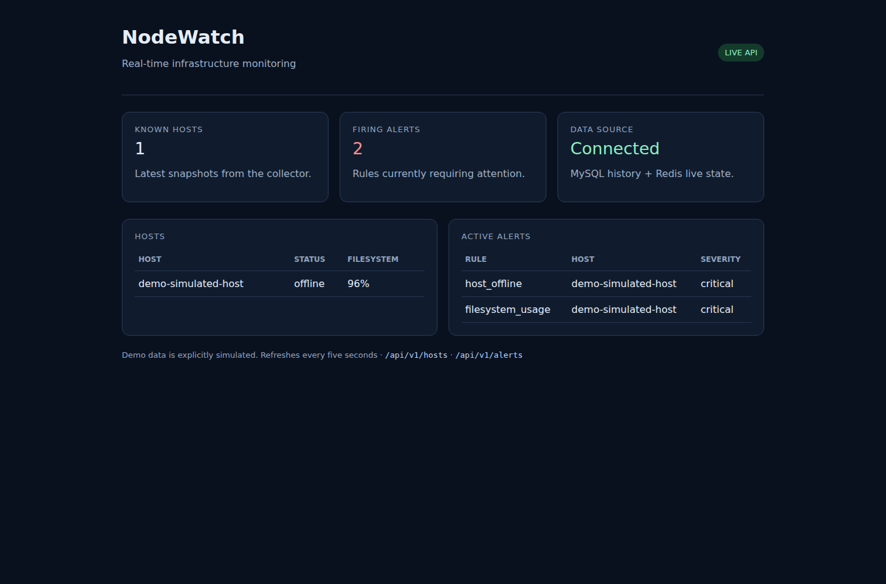
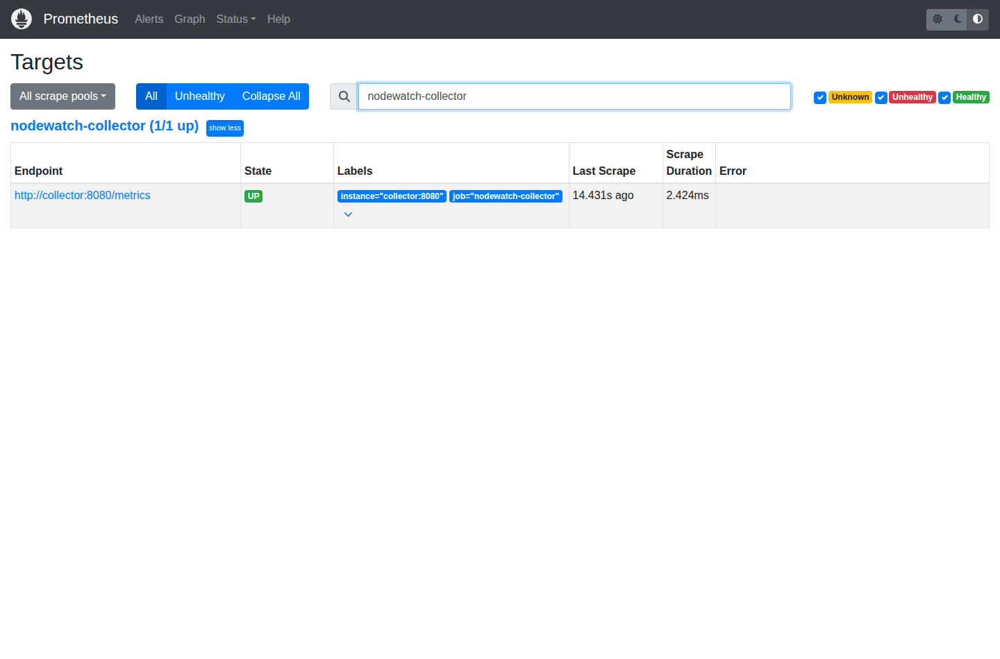
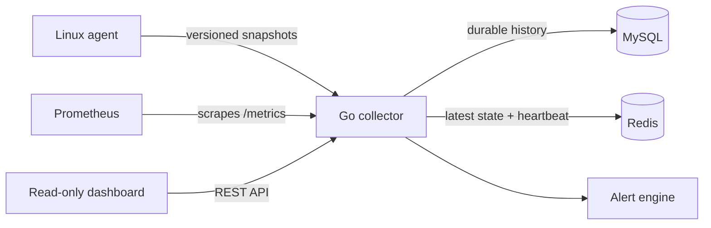

# NodeWatch

**Real-time Linux infrastructure monitoring built with Go.**

NodeWatch pairs a lightweight Linux agent with a Go collector that records durable history in MySQL, maintains live state in Redis, evaluates alerts, and exposes Prometheus metrics. It demonstrates strict ingestion, idempotent storage, health checks, reconciliation, and a reproducible cloud demo.

## Running demo

These screenshots were captured by the GitHub-hosted Cloud demo workflow. They show an explicitly **simulated** host snapshot.

| Live host view | Firing alert | Prometheus scrape |
| --- | --- | --- |
|  |  |  |

## Highlights

- Collects Linux CPU, I/O wait, memory, load, filesystem, and disk metrics from `/proc`.
- Persists idempotent snapshot history in MySQL and live heartbeat state in Redis.
- Tracks `online`, `stale`, `offline`, and `unknown` host state.
- Evaluates filesystem, CPU I/O-wait, and offline-host alert lifecycles.
- Provides REST, health/readiness, Prometheus, and a lightweight read-only dashboard endpoints.
- Includes hardened Docker Compose plus separate unit, service-container integration, and cloud-demo workflows.

## Architecture



MySQL is the source of truth for history. Redis supplies fast latest-state reads; a reconciliation worker repairs it after transient cache failures. The collector commits MySQL before Redis, so identical snapshots can be retried safely.

## Technology stack

| Area | Choice |
| --- | --- |
| Services | Go 1.22, `net/http`, Prometheus client |
| Durable data | MySQL 8.4 |
| Live state | Redis 7.4 |
| Orchestration | Docker Compose |
| Verification | Go tests, GitHub Actions, Playwright/Chromium |

## Agent, collector, and alerts

The Linux agent reads `/proc` and filesystems, then posts snapshots to `POST /api/v1/metrics`. The collector validates each payload, stores history, refreshes a heartbeat, and serves the host view. Alerts transition through `pending`, `firing`, and `resolved`.

- `filesystem_usage`: warning at 85%, critical at 95%
- `cpu_iowait`: warning at 20%, critical at 40%
- `host_offline`: Redis heartbeat has expired

## Prometheus

Prometheus scrapes `/metrics` across the internal Compose network.

```promql
sum(rate(nodewatch_http_requests_total[5m])) by (route, status)
sum(rate(nodewatch_ingestions_total[5m])) by (outcome)
nodewatch_active_alerts{state="firing"}
```

## API

| Endpoint | Description |
| --- | --- |
| `POST /api/v1/metrics` | Ingest an agent snapshot |
| `GET /api/v1/hosts` | List hosts and live status |
| `GET /api/v1/hosts/{id}` | Get latest host snapshot |
| `GET /api/v1/hosts/{id}/metrics` | Query historical snapshots |
| `GET /api/v1/alerts` | List alerts |
| `GET /dashboard` | Lightweight live monitoring view |
| `GET /healthz`, `GET /readyz` | Liveness and readiness |

```sh
curl http://localhost:8080/api/v1/hosts
curl 'http://localhost:8080/api/v1/alerts?state=firing&limit=20'
```

## Quick start

```sh
cp .env.example .env
# Replace all password placeholders in .env.
docker compose config --quiet
docker compose up --build -d
until curl --fail --silent http://localhost:8080/readyz; do sleep 1; done
until curl --fail --silent http://localhost:9090/-/ready; do sleep 1; done
```

The collector is at `http://localhost:8080`, the dashboard at `http://localhost:8080/dashboard`, and Prometheus at `http://localhost:9090`. MySQL and Redis have no public ports.

Run the Linux agent from a Linux host that can reach the collector:

```sh
NODEWATCH_NODE_ID=linux-01 \
NODEWATCH_COLLECTOR_URL=http://localhost:8080/api/v1/metrics \
go run ./cmd/agent
```

## Simulated demo

Set `NODEWATCH_ALERT_EVALUATION_INTERVAL=1s` and `NODEWATCH_ALERT_FOR=0s` in `.env`, then run:

```sh
go run ./cmd/demo --url http://localhost:8080/api/v1/metrics \
  --node-id demo-simulated-host --filesystem-used-percent 96
sleep 3
curl http://localhost:8080/api/v1/hosts/demo-simulated-host
curl 'http://localhost:8080/api/v1/alerts?state=firing&limit=20'
curl -G http://localhost:9090/api/v1/query --data-urlencode 'query=up{job="nodewatch-collector"}'
docker compose down
```

The demo generator submits simulated metrics only. See [docs/DEMO.md](docs/DEMO.md) for a fuller walkthrough.

## Development and testing

```sh
go test -timeout 60s ./...
go vet ./...
go build ./...
GOOS=linux GOARCH=amd64 CGO_ENABLED=0 go build ./cmd/agent
GOOS=linux GOARCH=amd64 CGO_ENABLED=0 go build ./cmd/collector
```

GitHub Actions runs portable checks and a separate disposable MySQL/Redis integration job. [Cloud demo evidence](.github/workflows/cloud-demo.yml) runs Compose, verifies persistence, alerting, `/metrics`, and Prometheus scraping, then uploads screenshots and logs.

## Repository layout

```text
cmd/agent/          Linux agent
cmd/collector/      Collector process and lifecycle wiring
cmd/demo/           Explicitly simulated snapshot generator
internal/alerts/    Alert rules and lifecycle
internal/collector/ HTTP API and dashboard
internal/storage/   MySQL and Redis adapters
deploy/prometheus/  Prometheus scrape configuration
docs/               Demo and testing documentation
```

## Security and license

The Compose collector and Prometheus ports are loopback-only; MySQL and Redis remain internal. NodeWatch does not provide authentication or TLS termination, so place it behind an authenticated HTTPS reverse proxy for untrusted networks. Secrets belong in the ignored `.env` file.

Licensed under [MIT](LICENSE). See [CONTRIBUTING.md](CONTRIBUTING.md) and [ARCHITECTURE.md](ARCHITECTURE.md).
