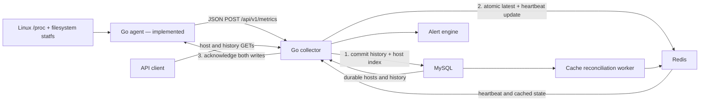

# NodeWatch

Lightweight Linux host monitoring in Go, with an explicit path from host metrics to a central infrastructure observability service.

**Status: five-milestone implementation complete.** The collector accepts the existing agent payload, validates it, persists history, tracks heartbeat availability, exposes Prometheus metrics, evaluates bounded in-memory alerts, and repairs Redis from durable MySQL history. This is implemented infrastructure code, not a claim of production deployment certification. Real-service integration and container execution remain unverified in the current Windows environment.

## Feature status

| Area | Status | Evidence / limit |
| --- | --- | --- |
| Linux agent, collector, MySQL, Redis, alerts, and cache repair | Implemented | Unit tests, emulator tests, native builds, and Linux cross-builds pass. |
| Docker deployment hardening | Implemented, unverified here | Non-root runtime, read-only collector filesystem, dependency health gates, persistent data volumes, and loopback-only publication are configured; Docker is unavailable in this environment. |
| GitHub Actions CI | Implemented, unverified here | Workflow separates unit checks from disposable real MySQL/Redis integration tests. |
| Prometheus instrumentation | Implemented, locally verified | Official `client_golang` powers `/metrics`; unit tests gather metric families and verify exposition. Live Compose scraping remains unverified because Docker is unavailable. |
| Live Linux collection, Compose run, and real service integration | Unverified here | This Windows environment has no Docker engine, Redis server, or MySQL server. |
| Authentication, TLS, durable notifications, retention, UI | Planned | These are not included. |

The module path is `github.com/RaafidAfraazG/NodeWatch`.

## Features

Implemented:

- [x] CPU utilization from successive aggregate `/proc/stat` samples
- [x] Memory total, available, and used percentage from `/proc/meminfo`
- [x] One-, five-, and fifteen-minute load averages
- [x] Filesystem capacity and usage for configured paths (root filesystem by default)
- [x] Cumulative disk read/write operations and bytes from `/proc/diskstats`
- [x] Node ID, hostname, OS, architecture, and UTC collection timestamp
- [x] Environment and flag configuration, structured JSON logs, graceful cancellation
- [x] HTTP timeouts, bounded exponential retries, explicit partial metric errors
- [x] Fixture-based parser tests and configuration/HTTP behavior tests
- [x] Collector ingestion, health/readiness, host lookup/listing, and bounded history APIs
- [x] MySQL transactions, unique snapshot identities, conflict detection, and versioned migration
- [x] Redis latest-state cache, atomic ordering, and expiring heartbeat keys
- [x] Multi-stage collector Dockerfile and Compose services with persistent database volumes
- [x] CPU I/O-wait collection, freshness-aware `online`/`offline`/`stale`/`unknown` host states
- [x] In-memory alert lifecycle for offline hosts, filesystem use, and CPU I/O wait
- [x] Bounded, cancellable cache reconciliation with retry and jitter
- [x] Unit/HTTP tests and Redis emulator tests; separate opt-in real-service tests

Verification status:

- [x] Portable Go unit tests, including the existing agent HTTP client against the collector
- [x] Redis Lua/TTL behavior tested using **miniredis**, an emulator
- [ ] Real Redis and MySQL integration execution in this environment
- [ ] Docker Compose validation, image build, and live service health checks in this environment
- [ ] Live Linux agent collection in this Windows environment

Planned:

- [x] Official Prometheus exposition, Go/process runtime metrics, bounded collector metrics, and Compose scrape configuration
- [ ] Authentication/TLS termination and retention policy
- [x] GitHub Actions workflow for portable and service-container integration checks
- [ ] Verified Compose demo screenshots from a Docker-capable environment

## Architecture



See [ARCHITECTURE.md](ARCHITECTURE.md) for the wire contract, sampling semantics, and failure behavior.

## Technology stack

Implemented: Go 1.22 or newer, Linux procfs/`statfs`, JSON/HTTP, `log/slog`, MySQL via `database/sql` and `go-sql-driver/mysql`, Redis via `go-redis/v9`, Prometheus via the official `client_golang`, and Docker Compose manifests. The agent still uses only the standard library. Miniredis is a test-only dependency. Versions and checksums are pinned in `go.mod` and `go.sum`.

## Repository structure

```text
cmd/agent/           Agent executable and signal handling
cmd/collector/       HTTP service, migration command, container health check
internal/metrics/   Portable parsers, JSON types, Linux collection
  testdata/         Representative procfs fixtures
internal/agent/     Sampling loop and HTTP delivery
internal/config/    Defaults, environment/flag parsing and validation
internal/collector/ Strict decoding, validation orchestration, HTTP endpoints
internal/alerts/    Alert rules, lifecycle state, and evaluator worker
internal/recovery/  Bounded Redis reconciliation and retry worker
internal/storage/   History/cache interfaces and MySQL/Redis adapters
  mysql/migrations/ Embedded, versioned SQL migration
.github/            Reserved for future CI configuration
docs/images/        Reserved for real screenshots and diagrams
docs/SCREENSHOTS.md Milestone 5 evidence plan
```

## Build and test

With Go available in the execution environment:

```sh
make build
make test
make lint
```

Equivalent Go commands (also usable on Windows for parser tests and builds):

```sh
go test -timeout 60s ./...
go vet ./...
go build ./...
go build -o bin/agent ./cmd/agent
go build -o bin/collector ./cmd/collector
```

The Makefile uses a POSIX shell, `find`, and `gofmt`. `make lint` checks formatting and runs `go vet`; it does not require a third-party linter. Use `make fmt` to apply formatting.

GitHub Actions runs the same unit checks plus separate MySQL/Redis integration tests against disposable service containers. Its workflow is [ci.yml](.github/workflows/ci.yml). It has read-only repository permissions and uses no deployment secrets.

Run the agent **on Linux**, pointing at an HTTP receiver that you control:

```sh
NODEWATCH_NODE_ID=demo-linux \
NODEWATCH_COLLECTOR_URL=http://localhost:8080/api/v1/metrics \
NODEWATCH_MOUNTS=/,/var \
make run-agent

# Equivalent invocation with flags:
go run ./cmd/agent --node-id demo-linux --interval 10s --mounts /,/var
go run ./cmd/agent --help
```

Start the collector using the deployment instructions below. The agent logs delivery failure after bounded retries and continues sampling; failed snapshots are not spooled. Use Ctrl+C or SIGTERM to stop gracefully. The non-Linux agent build reports unsupported metrics and never fabricates Linux measurements. The agent and collector are independent processes; the agent need not be containerized.

## Configuration

Flags override environment variables, which override defaults. Empty environment variables use defaults. Invalid settings fail before collection starts.

| Environment variable | Flag | Default | Validation / meaning |
| --- | --- | --- | --- |
| `NODEWATCH_COLLECTOR_URL` | `--collector-url` | `http://localhost:8080/api/v1/metrics` | Absolute HTTP(S) URL; no user info, query, or fragment |
| `NODEWATCH_NODE_ID` | `--node-id` | Hostname | 1–128 UTF-8 bytes; no surrounding whitespace, control characters, `/`, `\`, or `.`/`..` IDs; stable and unique |
| `NODEWATCH_INTERVAL` | `--interval` | `10s` | Go duration, 1s–24h |
| `NODEWATCH_HTTP_TIMEOUT` | `--http-timeout` | `5s` | Per attempt, greater than zero and at most 1m |
| `NODEWATCH_MAX_RETRIES` | `--max-retries` | `3` | Additional attempts, integer 0–5 |
| `NODEWATCH_MOUNTS` | `--mounts` | `/` | Comma-separated absolute Linux paths; duplicates removed |

Paths resolve to their containing filesystem; using two paths on the same filesystem produces two entries. Mount autodetection is not implemented. Do not use sensitive directory names as configured paths: those paths appear in the payload. No credentials, process environments, personal file contents, or unrelated host data are collected. Transport authentication is not implemented; use a trusted test network or an HTTPS receiver under your control.

## Example JSON payload

Illustrative schema example, **not captured application output**. Counters and percentages below are sample values; actual snapshots reflect the host. CPU is omitted on the first collection and `errors.cpu` explains the warm-up.

```json
{
  "schema_version": 1,
  "node_id": "demo-linux",
  "hostname": "demo-linux",
  "os": "linux",
  "architecture": "amd64",
  "collected_at": "2026-10-21T12:00:00Z",
  "cpu": { "utilization_percent": 25 },
  "memory": { "total_bytes": 8388608, "available_bytes": 2097152, "used_percent": 75 },
  "load": { "one": 0.25, "five": 1.5, "fifteen": 2.75 },
  "filesystems": [{
    "mount_point": "/",
    "total_bytes": 107374182400,
    "free_bytes": 42949672960,
    "available_bytes": 37580963840,
    "used_percent": 60
  }],
  "disks": [{
    "device": "sda",
    "reads_completed": 10,
    "writes_completed": 20,
    "read_bytes": 51200,
    "written_bytes": 102400
  }]
}
```

Unavailable metric fields are omitted rather than reported as zero. Partial failures add an `errors` object, for example `{"cpu":"warming up: CPU requires two samples"}`. Consumers must distinguish absent measurements from genuine zero values.

## Collector deployment and migrations

Compose defines MySQL 8.4, Redis 7.4, and the collector. `.env.example` contains placeholders only; supply unique passwords in an ignored `.env` or the process environment. Environment variables are read by Compose; running the collector directly does **not** automatically load `.env`.

```sh
# After supplying MYSQL_ROOT_PASSWORD, MYSQL_PASSWORD and REDIS_PASSWORD:
docker compose config --quiet
docker compose up --build -d
docker compose ps
curl http://localhost:8080/healthz
curl http://localhost:8080/readyz
```

The default published address is loopback-only (`127.0.0.1:8080`); Redis and MySQL are not published to the host. For agents on other machines, provide a trusted network/reverse-proxy route to the collector and set their collector URL accordingly. Authentication and TLS termination are not implemented by this service. Do not expose it as an unauthenticated public ingestion endpoint.

The runtime image contains only the collector binary and CA certificates, runs as an unprivileged `nodewatch` user, and uses a direct executable entrypoint for signal delivery. Compose starts the collector only after MySQL and Redis report healthy, makes its root filesystem read-only, drops Linux capabilities, and supplies a small writable `/tmp`. The collector health check deliberately uses `/readyz`, so it stays unhealthy until both dependencies and the expected schema are ready.

MySQL and Redis have persistent named volumes. Ordinary `docker compose down` preserves these volumes. Changing database passwords in `.env` does not rotate credentials in an already initialized MySQL volume; rotate database credentials explicitly. Compose enables `NODEWATCH_AUTO_MIGRATE=true` for this initial schema.

Compose also starts Prometheus on `127.0.0.1:9090`, scraping `collector:8080/metrics` over the internal Compose network. It retains its time-series database in `prometheus-data`. The published Prometheus port is loopback-only, like the collector.

Outside Compose, provision an empty MySQL database and an account with appropriate privileges, set the `NODEWATCH_*` variables below, then run:

```sh
go run ./cmd/collector migrate
go run ./cmd/collector
```

Migration `001_initial.sql` is embedded in the binary. A connection-scoped migration lock serializes startup migration; the version is recorded only after successful DDL. MySQL DDL is **not** wrapped in an atomic transaction. Initial `CREATE TABLE IF NOT EXISTS` statements can safely replay after interruption. Existing table definitions are not automatically repaired. Manual migration with a separate privileged account is preferable to leaving DDL rights on the serving account. There is no down migration or time partitioning. Startup fails cleanly if required dependencies or schema version 1 are unavailable; a later outage makes `/readyz` return 503 while `/healthz` stays live.

## Collector environment reference

| Variable | Default | Meaning |
| --- | --- | --- |
| `NODEWATCH_BIND` | `:8080` | HTTP listen host:port |
| `NODEWATCH_REQUEST_TIMEOUT` | `10s` | Handler and body-read deadline, 1s–1m; at least twice dependency timeout |
| `NODEWATCH_DEPENDENCY_TIMEOUT` | `2s` | Each storage operation, 100ms–30s |
| `NODEWATCH_SHUTDOWN_TIMEOUT` | `15s` | Graceful drain, 1s–1m |
| `NODEWATCH_MAX_BODY_BYTES` | `1048576` | Ingest body cap, 1 KiB–4 MiB |
| `NODEWATCH_HEARTBEAT_TTL` | `30s` | Presence window, 1s–24h; set above agent interval plus expected delivery delays |
| `NODEWATCH_FRESHNESS_THRESHOLD` | `2m` | Measurement-age limit for the `stale` host state, 1s–24h |
| `NODEWATCH_ALERT_EVALUATION_INTERVAL` | `10s` | Alert scan period, 1s–1h |
| `NODEWATCH_ALERT_FOR` | `30s` | Continuous condition time before an alert fires, 0–24h |
| `NODEWATCH_FILESYSTEM_WARNING_PERCENT` | `85` | Filesystem alert warning threshold, >0–100 |
| `NODEWATCH_FILESYSTEM_CRITICAL_PERCENT` | `95` | Filesystem alert critical threshold, warning–100 |
| `NODEWATCH_IOWAIT_WARNING_PERCENT` | `20` | CPU I/O-wait alert warning threshold, >0–100 |
| `NODEWATCH_IOWAIT_CRITICAL_PERCENT` | `40` | CPU I/O-wait alert critical threshold, warning–100 |
| `NODEWATCH_RECONCILIATION_INTERVAL` | `30s` | Redis repair scan period, 1s–1h |
| `NODEWATCH_RECONCILIATION_BATCH_SIZE` | `100` | Hosts considered per repair page, 1–200 |
| `NODEWATCH_RECONCILIATION_MAX_BATCHES` | `5` | Maximum repair pages per interval, 1–100 |
| `NODEWATCH_CACHE_RETRY_ATTEMPTS` | `3` | Extra cache-write attempts with bounded backoff, 0–8 |
| `NODEWATCH_REDIS_ADDR` | `127.0.0.1:6379` | Redis TCP address |
| `NODEWATCH_REDIS_USERNAME` | empty | Optional Redis ACL username |
| `NODEWATCH_REDIS_PASSWORD` | empty | Redis password; Compose requires one |
| `NODEWATCH_REDIS_DB` | `0` | Standalone Redis database, 0–15 |
| `NODEWATCH_MYSQL_ADDR` | `127.0.0.1:3306` | MySQL TCP address |
| `NODEWATCH_MYSQL_USER` | `nodewatch` | Application user |
| `NODEWATCH_MYSQL_PASSWORD` | **required** | Database password; never returned to clients |
| `NODEWATCH_MYSQL_DATABASE` | `nodewatch` | Existing database |
| `NODEWATCH_MYSQL_MAX_OPEN` | `20` | Pool cap, 1–1000 |
| `NODEWATCH_MYSQL_MAX_IDLE` | `5` | Idle pool cap, 0–max open |
| `NODEWATCH_MYSQL_CONN_LIFETIME` | `3m` | Maximum connection age, 1s–1h |
| `NODEWATCH_AUTO_MIGRATE` | `false` | Apply initial migration at startup |

Compose's `MYSQL_PASSWORD` maps to `NODEWATCH_MYSQL_PASSWORD`, and `REDIS_PASSWORD` maps to `NODEWATCH_REDIS_PASSWORD`. `MYSQL_ROOT_PASSWORD` is used only by the MySQL container. The collector never needs the root password.

## HTTP API

All application responses use JSON. Error shape: `{"error":{"code":"snapshot_conflict","message":"..."}}`. Internal SQL/Redis errors and request bodies are not logged or sent to clients; request logs include method, status, and duration.

| Method and route | Behavior |
| --- | --- |
| `GET /healthz` | 200 while serving; no dependency calls |
| `GET /readyz` | 200 when Redis and MySQL/schema are ready, otherwise 503 |
| `POST /api/v1/metrics` | Existing v1 snapshot; 201 new, 200 identical duplicate, 409 conflict |
| `GET /api/v1/hosts?limit=50&after=host-a` | Durable known-host catalog with latest metrics, last-seen time, and `online`/`offline`/`stale`/`unknown`; maximum limit 200 |
| `GET /api/v1/hosts/{id}` | One established host; 404 if never reported, 400 for invalid ID |
| `GET /api/v1/hosts/{id}/metrics` | Descending history; default last hour and 100 records; maximum 31-day range and 1000 records |
| `GET /api/v1/alerts?state=pending&limit=100` | In-memory alerts, optionally filtered by `pending`, `firing`, or `resolved`; maximum limit 500 |
| `GET /api/v1/alerts/{id}` | One alert by its opaque ID; 404 if it is no longer retained |
| `GET /metrics` | Official Prometheus/OpenMetrics exposition; it is intentionally excluded from HTTP self-observation |

```sh
curl http://localhost:8080/api/v1/hosts
curl http://localhost:8080/api/v1/hosts/demo-linux
curl -G http://localhost:8080/api/v1/hosts/demo-linux/metrics \
  --data-urlencode 'from=2026-10-21T10:00:00Z' \
  --data-urlencode 'to=2026-10-21T12:00:00Z' \
  --data-urlencode 'limit=100'
# snapshot.json should be an actual agent snapshot, or an explicitly labeled test fixture:
curl -i http://localhost:8080/api/v1/metrics \
  -H 'Content-Type: application/json' --data-binary @snapshot.json
```

History uses an inclusive `from`, exclusive `to`, and optional exclusive `before` RFC3339Nano cursor. Keep `from` and `to` from the first response unchanged across pages. Continue with `next_before`; host listing uses `next_after` and binary UTF-8 ID ordering. Nonempty pages always include a continuation cursor, which may lead to a final empty page. Pages also stop at approximately 8 MiB of stored snapshot JSON. Unknown, empty, or repeated query parameters are rejected. URL-encode IDs and cursors as needed. Queries require MySQL; host availability also requires Redis, whose outage returns 503 rather than falsely declaring hosts offline.

Ingestion requires exactly one JSON object with case-sensitive schema fields. Unknown/duplicate keys, null values, incomplete metric objects, invalid UTF-8, and trailing JSON are rejected (400). Unsupported media types return 415, oversized bodies 413, and invalid IDs/timestamps/numeric ranges 422. Collection timestamps preserve nanoseconds, must be from year 2000 onward, and may be at most two minutes ahead of the collector clock. Missing metric objects are supported, including the agent's first CPU sample and explicit error-only snapshots. Negative or non-finite load, percentages outside 0–100, and inconsistent memory/filesystem counts are rejected. Historical backfill is allowed; arrival is not evidence that the measurement itself is fresh.

## Storage and retry semantics

- **MySQL:** `snapshots` stores full JSON plus SHA-256 content hash, with primary key `(host_id, collected_ns)`. The composite key supports per-host time queries and preserves nanoseconds. `hosts` holds monotonic latest collection and last-received timestamps. Snapshot and host-index changes commit in one transaction; `schema_migrations` records schema version 1.
- **Redis:** `nodewatch:host:<id>:latest` is a persistent hash with `snapshot`, `collected_ns`, and `seen_ns`. `nodewatch:host:<id>:heartbeat` is a string with an absolute TTL deadline. A Lua script protects both against concurrent/out-of-order writes. Host listing uses the indexed MySQL catalog and a Redis pipeline, avoiding Redis key scans and keeping known hosts visible after cache loss. This implementation targets standalone Redis, not Redis Cluster.
- **Availability:** heartbeat present means `online`, except a latest snapshot older than `NODEWATCH_FRESHNESS_THRESHOLD` is `stale`; heartbeat expired with cached latest state means `offline`; missing cache state means `unknown`. Last-seen time is collector receipt time. Duplicate and late valid submissions refresh presence, so online describes recent accepted contact, not necessarily fresh measurements. Hosts that never reported return 404.
- **Idempotency:** identity is exact `(validated node_id, collection instant at nanosecond precision)`. UTC-normalized typed JSON is hashed, making whitespace, object-key order, and equivalent timezone representations irrelevant. Array order and actual metric/error changes matter. Identical retries return `duplicate`; conflicting content returns 409 without refreshing Redis.
- **Ordering:** commit MySQL first, then update Redis, then acknowledge. A MySQL failure never writes Redis or returns success. If MySQL commits but Redis fails, the response is 503; resubmitting the same snapshot detects the stored duplicate and repairs Redis from MySQL's latest host state. A commit-response loss is also safe to retry. These are two independent stores, not a distributed atomic transaction.

If the agent exhausts retries after a partial failure, history may already be durable while the cache remains stale. The reconciliation worker traverses the durable host catalog in bounded pages and rewrites cache state with bounded exponential backoff and jitter. It is best-effort: MySQL remains authoritative, and a prolonged Redis outage still makes availability reads and readiness return 503. Collector and Redis clocks must be synchronized because heartbeat expiry uses the collector's absolute receipt deadline. There is no retention/deletion job, automatic partitioning, durable agent spool, or exact global read snapshot across multiple stores.

## Alerts

The collector evaluates each host page periodically. `host_offline` is critical when Redis reports an expired heartbeat; `filesystem_usage` and `cpu_iowait` use the configured warning and critical thresholds. CPU I/O wait is optional to preserve compatibility with agents built before this field existed. Each condition enters `pending`, becomes `firing` after `NODEWATCH_ALERT_FOR` of continuous detection, and becomes `resolved` after the condition clears on a scanned host. Repeated evaluations update one alert identity instead of creating duplicates. Alerts live only in collector memory and retain the most recent 10,000 entries; they are intentionally not a paging, notification, or durable incident system.

## Prometheus

`GET /metrics` uses the official Prometheus handler and exports bounded labels only. It includes `nodewatch_http_requests_total`, `nodewatch_http_request_duration_seconds`, `nodewatch_ingestions_total`, `nodewatch_ingestion_errors_total`, `nodewatch_storage_operation_duration_seconds`, `nodewatch_known_hosts`, `nodewatch_online_hosts`, `nodewatch_active_alerts`, and standard Go/process metrics. Labels never include node IDs, request URLs, raw paths, credentials, or raw storage errors.

```promql
sum(rate(nodewatch_http_requests_total[5m])) by (route, status)
sum(rate(nodewatch_ingestions_total[5m])) by (outcome)
histogram_quantile(0.95, sum(rate(nodewatch_storage_operation_duration_seconds_bucket[5m])) by (le, backend, operation))
nodewatch_active_alerts{state="firing"}
```

## Integration tests

See [docs/TESTING.md](docs/TESTING.md) for unit versus real-service coverage, isolated Compose tests, and exact environment variables. `make test-integration` opts into real-service tests; absent service variables cause explicit skips, not a claim of database validation.

## Demo

[docs/DEMO.md](docs/DEMO.md) describes a safe, repeatable Compose demo. It uses [cmd/demo/main.go](cmd/demo/main.go) to submit a clearly simulated filesystem snapshot, then inspects the host, historical data, and alert API. It does not create real disk pressure or collect live operating-system data.

## Known limitations

There is no authentication, durable agent queue, or durable notification system. Linux collection uses the host's current procfs/mount namespace; running inside a container does not automatically expose all host resources. Container and real-database verification are pending on a suitable execution host.

Validate the real-service test suite and Compose scrape flow first where Docker, Redis, and MySQL are available. Dashboard and publishing workflows remain out of scope. See [CONTRIBUTING.md](CONTRIBUTING.md), [the demo guide](docs/DEMO.md), and [the screenshot plan](docs/SCREENSHOTS.md).

Licensed under [MIT](LICENSE).
