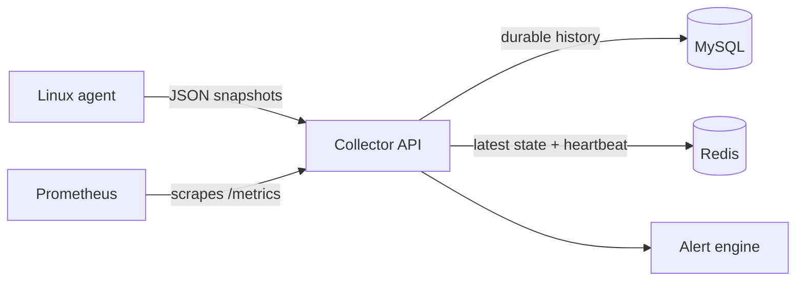

# NodeWatch

A lightweight Go monitoring stack for Linux hosts. NodeWatch collects `/proc` and filesystem metrics, stores durable history in MySQL, tracks live state in Redis, evaluates alerts, and exposes Prometheus metrics.

> **Status:** Feature-complete implementation with local unit/build verification. Docker, live MySQL/Redis, Prometheus scraping, and runtime screenshots still need verification on a Docker-capable host.

## Architecture



The diagram above documents the implemented data flow. Runtime screenshots will be added only after a real Compose demo run.

## What it does

| Capability | Status |
| --- | --- |
| Linux CPU, I/O wait, memory, load, filesystem, and disk metrics | Implemented |
| MySQL snapshot history and idempotent writes | Implemented |
| Redis latest state, heartbeat TTL, and cache reconciliation | Implemented |
| Host freshness: online, stale, offline, unknown | Implemented |
| Filesystem, I/O-wait, and offline-host alerts | Implemented |
| Prometheus `/metrics` endpoint | Implemented |
| GitHub Actions unit and service-container integration jobs | Configured |
| Docker Compose demo, live scrape, and screenshots | Not verified in this environment |
| Authentication, TLS, durable notifications, retention jobs | Not implemented |

## Quick start

Create an ignored `.env` from `.env.example` and replace the password placeholders.

```sh
docker compose up --build -d
curl http://localhost:8080/readyz
curl http://localhost:9090/-/ready
```

The collector is published only on `127.0.0.1:8080`; Prometheus is on `127.0.0.1:9090`. MySQL and Redis stay inside the Compose network.

Run the Linux agent separately:

```sh
NODEWATCH_NODE_ID=demo-linux \
NODEWATCH_COLLECTOR_URL=http://localhost:8080/api/v1/metrics \
go run ./cmd/agent
```

## Safe demo

The demo generator submits **simulated** data. It does not inspect or change disk pressure.

```sh
go run ./cmd/demo --url http://localhost:8080/api/v1/metrics
curl http://localhost:8080/api/v1/hosts/demo-simulated-host
curl 'http://localhost:8080/api/v1/alerts?state=firing&limit=20'
curl http://localhost:8080/metrics
```

For the full sequence, including a controlled filesystem alert, see [docs/DEMO.md](docs/DEMO.md).

## API

| Endpoint | Purpose |
| --- | --- |
| `POST /api/v1/metrics` | Ingest a v1 agent snapshot |
| `GET /api/v1/hosts` | List known hosts and current state |
| `GET /api/v1/hosts/{id}` | Get one host |
| `GET /api/v1/hosts/{id}/metrics` | Query bounded historical snapshots |
| `GET /api/v1/alerts` | List pending, firing, or resolved alerts |
| `GET /metrics` | Prometheus/OpenMetrics exposition |
| `GET /healthz` / `GET /readyz` | Liveness / dependency readiness |

An ingestion response looks like:

```json
{"status":"accepted","node_id":"demo-linux","collected_at":"2026-10-22T12:00:00Z"}
```

## Alerts and observability

Alerts transition through `pending` → `firing` → `resolved`. Supported rules are:

- `host_offline` — Redis heartbeat expired
- `filesystem_usage` — configured warning/critical threshold
- `cpu_iowait` — configured warning/critical threshold

Prometheus exports bounded-cardinality request, ingestion, storage, host, and alert metrics, plus Go and process metrics. It never labels metrics with host IDs, raw paths, credentials, or arbitrary error text.

```promql
sum(rate(nodewatch_http_requests_total[5m])) by (route, status)
sum(rate(nodewatch_ingestions_total[5m])) by (outcome)
nodewatch_active_alerts{state="firing"}
```

## Design notes

- **MySQL is authoritative** for host history.
- **Redis is derived state** for the latest snapshot and heartbeat.
- The collector commits MySQL before Redis. If Redis fails after a MySQL commit, clients retry the identical snapshot and the reconciliation worker repairs stale cache entries.
- This is **not** a distributed transaction; reads across the two stores are eventually consistent.

## Development

```sh
go test -timeout 60s ./...
go vet ./...
go build ./...
GOOS=linux GOARCH=amd64 CGO_ENABLED=0 go build ./cmd/agent
GOOS=linux GOARCH=amd64 CGO_ENABLED=0 go build ./cmd/collector
```

`make test-integration` runs real-service tests when the required MySQL and Redis environment variables are configured. GitHub Actions runs portable checks and a separate disposable MySQL/Redis job.

## Project layout

```text
cmd/agent/          Linux metrics agent
cmd/collector/      HTTP collector and lifecycle wiring
cmd/demo/           Simulated snapshot generator
internal/alerts/    Alert lifecycle and rules
internal/collector/ HTTP API and validation
internal/metrics/   Linux collection and parsers
internal/recovery/  Redis cache repair
internal/storage/   MySQL and Redis adapters
deploy/prometheus/  Prometheus scrape configuration
docs/               Demo and testing guides
```

## Security and limitations

NodeWatch does not implement authentication or TLS termination. Keep it on a trusted network or place it behind an authenticated HTTPS reverse proxy. It has no durable agent queue, notification delivery, data retention job, or Grafana dashboard.

Read [ARCHITECTURE.md](ARCHITECTURE.md), [docs/TESTING.md](docs/TESTING.md), and [CONTRIBUTING.md](CONTRIBUTING.md) for engineering detail.

Licensed under [MIT](LICENSE).
